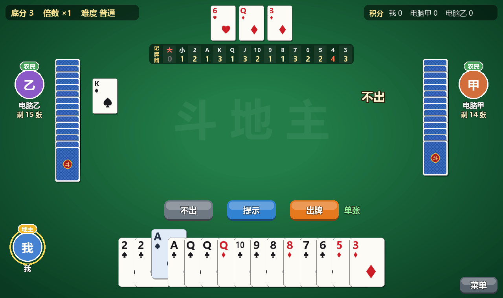
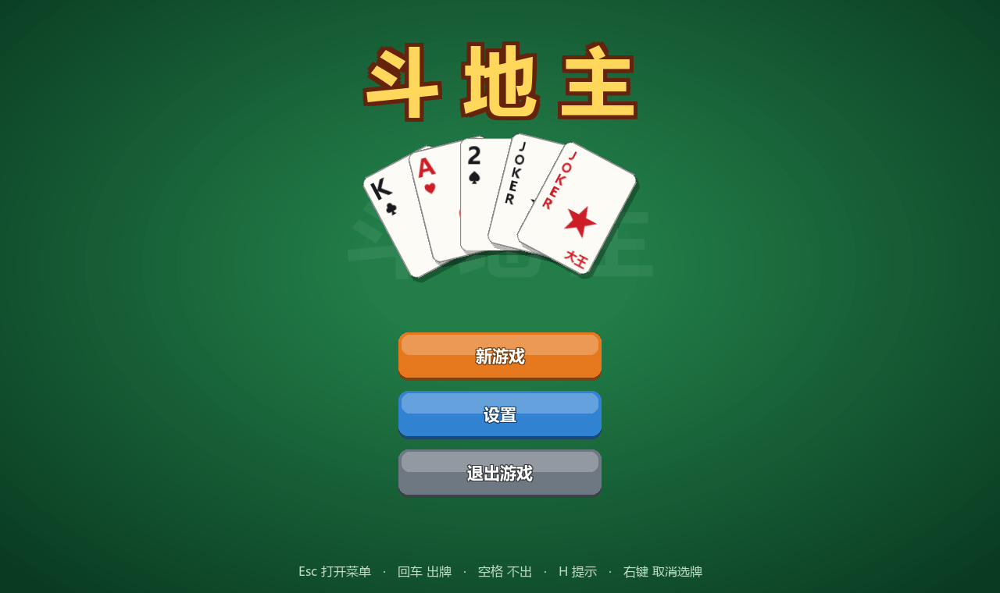

# 斗地主

单机版斗地主：你和两个电脑对战。用 Python + pygame 写成，所有音效都由程序现场合成，不需要任何图片或声音素材文件。



## 下载直接玩（Windows）

到 [Releases](../../releases/latest) 下载 `doudizhu.exe`，双击即可运行，不需要安装 Python。

> 第一次运行时 Windows 可能弹出"已保护你的电脑"：点「更多信息」→「仍要运行」。这是因为 exe 没有数字签名。

## 功能

- **完整规则**：叫分抢地主（1/2/3 分），支持单张、对子、三带一、三带二、顺子、连对、飞机（带单或带对）、四带二、四带两对、炸弹、王炸
- **计分**：底分 × 倍数，炸弹/王炸翻倍，春天/反春翻倍，多局累计积分
- **三档电脑难度**

  | 难度 | 电脑怎么打 |
  |---|---|
  | 简单 | 基础策略，适合熟悉规则 |
  | 普通 | 动态规划最优拆牌、记牌、判断自己的牌还有没有人管得上、残局算杀、农民之间互相配合 |
  | 困难 | 在普通的基础上，每步把没看到的牌随机分配几十次，每种出法都推演到终局，选赢面最大的 |

  电脑只用公开信息（自己的手牌、已出的牌、各家剩余张数、亮出的底牌），不会偷看你的牌。
  自我对战测试（同一副牌交换角色各打一次以抵消手气）：普通比简单的地主胜率高约 14 个百分点，困难比普通再高约 30 个百分点。

- **记牌器**：显示另外两家每种牌还剩几张，可能有炸弹/王炸的会标红
- **智能划选**：按住鼠标划过一串牌，自动挑出顺子/连对/飞机（例如划过 `334567` 选中 `34567`）；跟牌时会挑出最小的、能管上的同型牌；再划一次全部落下
- **提示按钮**：一键提示可出的牌，多按几次换一种；要不起时只显示一个「不出」
- **动画和音效**：发牌、出牌飞牌、底牌翻开、炸弹震屏和火花、胜利彩带
- **菜单和设置**：主菜单、Esc 暂停菜单；可调音量、电脑难度、显示模式（窗口化 / 全屏窗口化 / 全屏），设置自动保存



## 操作

| 操作 | 方式 |
|---|---|
| 选牌 | 单击牌；或按住鼠标划过多张 |
| 取消所有选择 | 右键 |
| 出牌 / 不出 / 提示 | 按钮，或 回车 / 空格 / H |
| 打开菜单 | Esc 或右下角「菜单」 |

## 从源码运行

需要 Python 3.8 及以上：

```bash
pip install -r requirements.txt
python main.py
```

Windows 下也可以直接双击 `start.bat`。

自己打包 exe：

```bash
pip install pyinstaller
pyinstaller --onefile --windowed --name doudizhu main.py
```

## 文件结构

| 文件 | 内容 |
|---|---|
| `main.py` | 入口：主菜单、暂停菜单、设置、显示模式 |
| `game.py` | 牌桌：发牌、叫分、出牌、结算、绘制、动画 |
| `rules.py` | 规则：牌型识别、大小比较、可出牌枚举 |
| `ai.py` | 难度分发、简单难度的策略、提示和智能划选 |
| `ai_hard.py` | 普通/困难难度：动态规划拆牌、记牌、蒙特卡洛搜索 |
| `sounds.py` | 用 numpy 合成的音效 |

## 说明

目前只支持 Windows：界面字体使用系统自带的微软雅黑，窗口定位用到了 Windows API。
